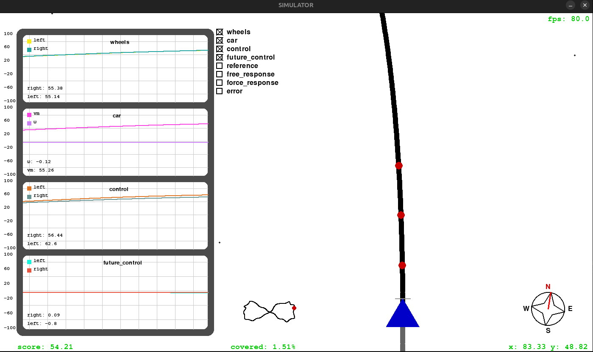

# Line Follower Simulator



# get the clean code on the clean_project branch

## Description
The **Line Follower Simulator** is a simulator for a line-following robot. It allows testing control algorithms and simulating the behavior of a robot on different types of tracks.

The car can be controlled by (`controller_type` in `main.py`):
- a **qLPV MPC** (quasi-Linear Parameter Varying Model Predictive Control) with different scheduling trajectory estimation strategies;
- a **GPC** linearized at `theta = 0` (heading and travelled distance as outputs, reference `theta_r = x / d0`).

## Features
- Simulation of line-following robots.
- Generation of tracks in different formats (circle, lemniscate).
- Graphical visualization of the robot's behavior (reference in red, MPC prediction in blue).
- qLPV MPC with box constraints on the inputs and offset-free tracking (input disturbance estimate).
- Scheduling trajectory estimation: `frozen`, `warm_start`, `taylor` and `iterative`.
- GPC computed from the motor parameters (free response from the wheels angle, step response, unconstrained law).
- The data of each run is saved in `runs/` (csv) to plot later.

## qLPV model
States `x = [w_l, w_r, theta, X, Y]` (wheels speed, heading, lateral and forward position in the car frame) and inputs `u = [u_l, u_r]` (% of PWM):

```
w(k+1)     = a w(k) + b (u(k) + d)
theta(k+1) = theta(k) + Ts r/L (w_l - w_r)(k+1)
X(k+1)     = X(k) + Ts v(k+1) sin(theta(k))
Y(k+1)     = Y(k) + Ts v(k+1) cos(theta(k))
```

The embedding `x(k+1) = A(rho) x(k) + B(rho) (u(k) + d)` is exact. The term `v sin(theta)` can be factorized in two ways (`embedding` in `main.py`):
- `sinc`: `rho = [cos(theta), v(k+1) sinc(theta)]`, the lateral position is linear in the heading;
- `sin_cos`: `rho = [sin(theta), cos(theta)]`, the lateral position is linear in the speed.

## Usage
```
python main.py
```
The configuration screen has one page for each area (controller, NMPC qLPV, GPC, track, car, motors,
perturbation, simulation and display). Press **Play** to run; when the run ends (end of the track, max time or `Esc`)
the results screen shows the summary, the trajectory and the lateral error, with the option to **save** the run,
run again or go back to the configuration. The last configuration is kept in `last_config.json`.

Keys during the run: `P`/`O` increase/decrease the motors perturbation, `R` resets it, `Esc` stops the run.

Headless comparison of the controllers (`--save` writes the csv of each run):
```
python compare_controllers.py 100 gpc frozen warm_start taylor iterative --save runs/compare
python compare_controllers.py 40 --perturbation 10 20 gpc taylor
```

## Saved data
Saved from the results screen (or with `--save` in `compare_controllers.py`):
- `runs/<name>.csv`: one row per step (time, pose of the car in the track coordinates, speeds, inputs,
  perturbation, lateral error, reference / prediction at `k+1` and `k+N`, scheduling and solver statistics);
- `runs/<name>_track.csv`: points of the track (same coordinates of the pose);
- `runs/<name>_meta.json`: configuration of the run.

```python
import pandas as pd, matplotlib.pyplot as plt
df, track = pd.read_csv("runs/taylor.csv"), pd.read_csv("runs/taylor_track.csv")
plt.plot(track.x, track.y); plt.plot(df.x, df.y); plt.axis("equal"); plt.show()
```

## Project Structure
- `main.py`: application (configuration screen -> simulation -> results).
- `config.py`: default settings and the schema of the configuration screen.
- `runner.py`: runs one simulation from a configuration (controller, control loop, data of the run).
- `graphics/menu.py`: configuration and results screens.
- `simulator.py`: implementation of the simulator.
- `compare_controllers.py`: headless comparison of the controllers.
- `run_logger.py`: saves the data of the runs (csv).
- `mpc/model.py`: qLPV model of the car.
- `mpc/scheduling.py`: scheduling trajectory estimation strategies.
- `mpc/qlpv_mpc.py`: qLPV MPC (condensed prediction and box constrained QP).
- `mpc/line_follower.py`: reference from the track, contouring weights and disturbance estimate.
- `mpc/gpc.py`: GPC linearized at `theta = 0`.
- `car_modeling/car_dynamics.py`: modeling of the car's dynamics.
- `graphics/track_generator.py`: track generation.
- `graphics/graphics_elements.py`: graphical elements for rendering.
